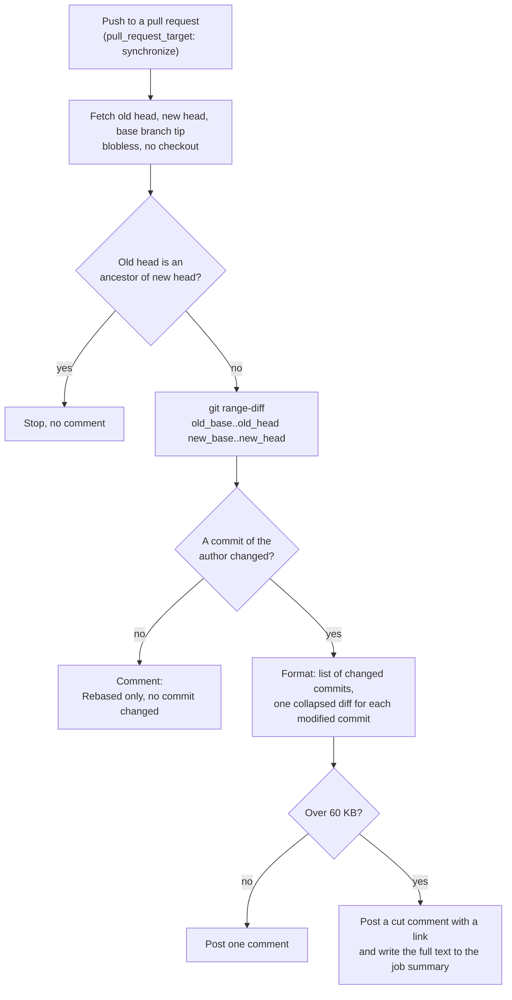

# Push-to-push diffs for review rounds on SCT pull requests

**Jira:** SCT-1395

**Status:** built

## Overview

A new workflow, `pr-range-diff`, runs on each push to a pull request. When
the push is a force-push, it runs `git range-diff` between the old series and
the new series. Each series starts at its own merge-base with the base
branch, so the commits that a rebase brings from `master` do not show. The
workflow posts the result as one comment on the pull request. The commits
standard tells the author to fold each review fix into its logical commit and
force-push. The reviewer reads the comment to check the review round. Each
later force-push also gets a comment, so the commits that merge are the
commits that the reviewers read.

The workflow is a port of `.github/workflows/pr-range-diff.yaml` from
scylladb/scylladb, commit `b97a8e03965e`.

## Constraints

- `pull_request_target` gives the job a write token, also for a fork pull
  request. The job fetches git objects only. It does not check out or run a
  file from the pull request.
- Commit titles and diff lines come from the author of the pull request. The
  comment must not let them add links, images, mentions, or HTML.
- GitHub limits a comment to 65536 characters.
- The job uses only the default `GITHUB_TOKEN`, and no repository secret.

## Design



`old_base` is the merge-base of the tip of the base branch and the old head.
`new_base` is the merge-base of the tip of the base branch and the new head.
The tip is at or after each commit that the author rebased on, so each
merge-base is the start of the series of the author.

The workflow is one job with these steps:

| Step | Does |
|---|---|
| Fetch | `git init`, then `git fetch --filter=blob:none` of the two heads and the base branch from the base repository |
| Detect | `git merge-base --is-ancestor` of the old head and the new head |
| Compute | `git range-diff --no-color` to a text file, with Python hunk headers |
| Format | An inline Python step parses the text file and writes the comment body |
| Post | `gh pr comment` with the body file |

The formatter stays inline in the workflow file and stays near the scylla
text. A later fix in scylla then applies with a small diff.

The workflow runs for each author, and for draft pull requests. It lives on
`master` only. `pull_request_target` takes the workflow file from the default
branch for a pull request to any branch, so it also runs for the backport
pull requests to the release branches. The base of each series is the tip of
the base branch of the pull request. The pull request that adds the workflow
carries the `backport/none` label.

Each force-push gets a new comment, and each comment stays as posted. The
timeline of the pull request then holds one diff for each review
round, next to the review comments of that round.

| Condition | Behavior |
|---|---|
| The push only adds commits | No comment. GitHub shows the new commits |
| The force-push only rebases | The comment says `Rebased only; no commit changed.` |
| The comment is over 60 KB | The comment keeps what fits, closes its open blocks, and links to the job summary. The job summary holds the full text |
| The fetch of a SHA fails | The job fails. The pull request shows a failed check and gets no comment |
| `gh pr comment` fails | The job fails. The workflow log holds the full range-diff |
| The job runs longer than 10 minutes | GitHub stops it |

## Contracts

### Inputs

The `pull_request_target` event, type `synchronize`:

```
github.event.before                      # old head SHA
github.event.after                       # new head SHA
github.event.pull_request.base.ref       # base branch
github.event.pull_request.number
github.server_url, github.repository, github.run_id
```

Permissions of the job:

```yaml
permissions:
  contents: read
  pull-requests: write
```

### Outputs

The comment on the pull request:

````markdown
### Changes since previous version ([`<old 10>`](<commit url>) → [`<new 10>`](<commit url>))

- `2/5` **modified**: [<commit title>](<commit url>)
- `5/5` **new**: [<commit title>](<commit url>)
- `–` **dropped**: [<commit title>](<commit url>)

<details><summary><b>2/5 <commit title></b> (<N> lines changed)</summary>

```diff
<range-diff of the commit pair>
```
</details>
````

The list holds only the commits that changed. The formatter escapes Markdown
and HTML in each commit title, and breaks each `@` with a zero-width space.
The fence of each diff block is longer than each backtick run in the diff.

`docs/standards/global/commits-and-pull-requests.md`, section "One Logical
Change per Commit":

> Each commit is one coherent step that a reviewer can read alone. During a
> review, fold each fix into the commit that it amends, and force-push. The
> `pr-range-diff` workflow posts the changes of each force-push as a comment
> on the pull request. The reviewer reads this comment to check the
> review round.

`.github/copilot-instructions.md`, section "Commit History and Squashing".
This text is the whole section:

> Keep one logical change per commit. During a review, fold each fix into
> the commit that it amends, and force-push the branch. When you cannot
> force-push, give the reviewer the hash of the folded branch. The
> `pr-range-diff` workflow shows the reviewer what changed. See
> `docs/standards/global/commits-and-pull-requests.md`.

`docs/development-flow.md`, section "Review", one more paragraph:

> During a review, the author folds each fix into its commit and
> force-pushes. The `pr-range-diff` workflow posts the changes of each
> force-push as a comment on the pull request.

## Risks

| Risk | Response |
|---|---|
| `git range-diff` fetches each blob that it needs in a separate request. A long series with many files can take minutes | The job stops after 10 minutes and shows a failed check. The author can still link a local `git range-diff` |
| A pull request with many force-pushes gets many comments | The diffs are collapsed. The reviewers report in the first weeks if the comments hide the discussion |
| Bots that rebase their pull requests get a comment for each rebase. The backport bot force-pushes its conflict fixes | A rebase gets the one line `Rebased only; no commit changed.` A conflict fix gets a diff that shows the fix |
| GitHub blocks `pull_request_target` in public repositories from 2026-12-02, unless an Actions event policy allows it. Ten SCT workflows already use this trigger. In the brownout of 2026-11-09, 16:00 to 18:00 UTC, each of their 26 runs ended in `startup_failure` | A scylladb org admin allows `pull_request_target` for this repository, or for each of its workflows. When the trigger stays blocked, the job shows a failed run and posts no comment |
| A fix that rewrites most of a small commit makes `git range-diff` pair no commits. The comment then shows the commit as dropped and new, with no diff of the fix | The title of the new commit matches the dropped one. The reviewer reads the new commit in full |
| A change to the comment format of `git range-diff` breaks the parser | The job runs on `ubuntu-latest`, as in scylla. The raw range-diff stays in the workflow log |

## Decisions

- SCT ports the range-diff workflow of scylla core. It is the only option
  that hides the commits that a rebase brings from `master`, and scylla runs
  it on each pull request. (user)
- The port differs from scylla in four points: it runs on drafts, it takes
  the tip of the base branch as the base, it sets Python hunk headers, and a
  failed `git range-diff` fails the job. (spec)
- The workflow comments on draft pull requests. The standard opens each pull
  request as a draft, and reviews start on drafts. (spec)
- The workflow runs for each author and for pull requests to each branch.
  A backport pull request with a conflict fix gets the diff of the fix.
  (spec)
- Each force-push gets its own comment. Each review round keeps its diff in
  the timeline. (spec)
- A force-push that only rebases gets a short comment. The reviewer learns
  that there is nothing to read again. (spec)
- The formatter stays inline. It is a near copy of the scylla formatter,
  which runs on each scylla pull request. Its checks are a local run of the
  workflow steps and a run in a fork, on a pull request between two branches
  of the fork. A pull request from a fork to SCT runs it only after the
  merge, because `pull_request_target` takes the file from `master`. (spec)
- The Copilot section holds the rule and a link to the standard. One
  source holds the rule. (spec)
- The Copilot agent force-pushes the folded branch. When it cannot
  force-push, it gives the hash of the folded branch to the reviewer. (spec)
